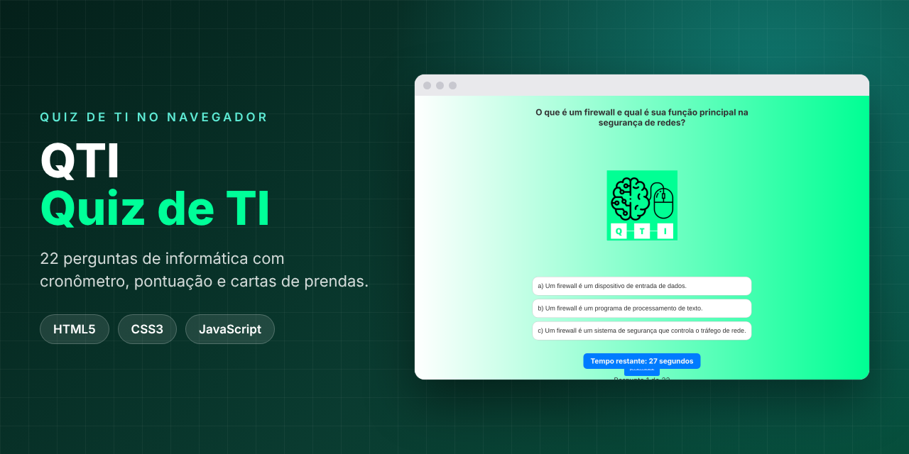
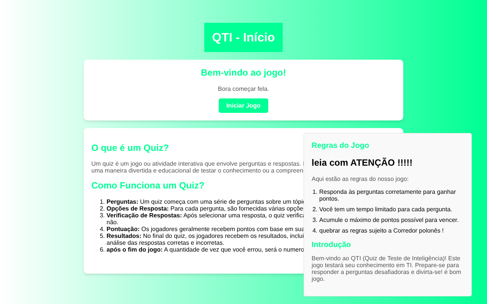
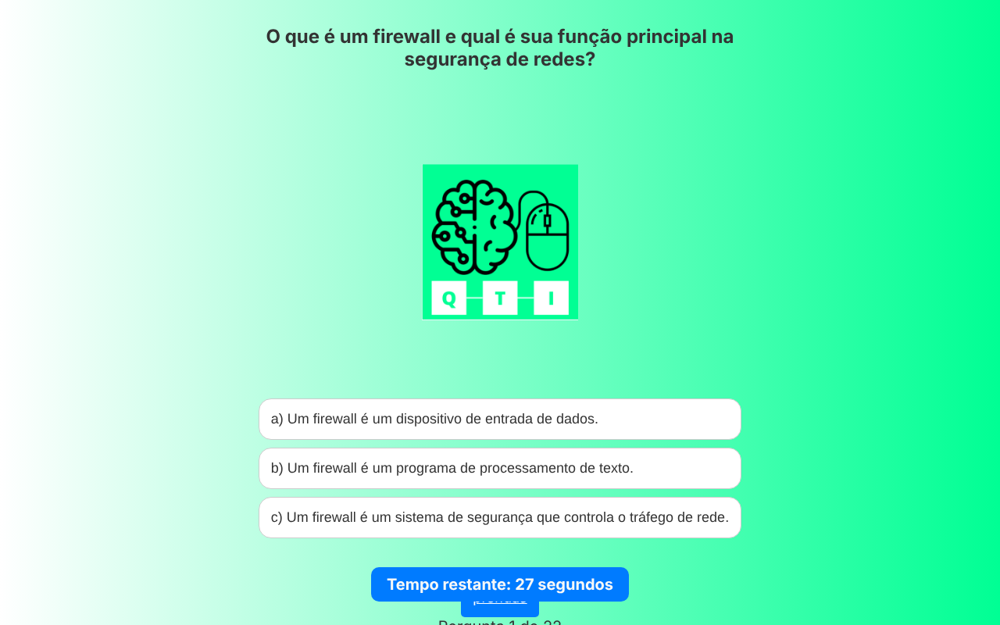
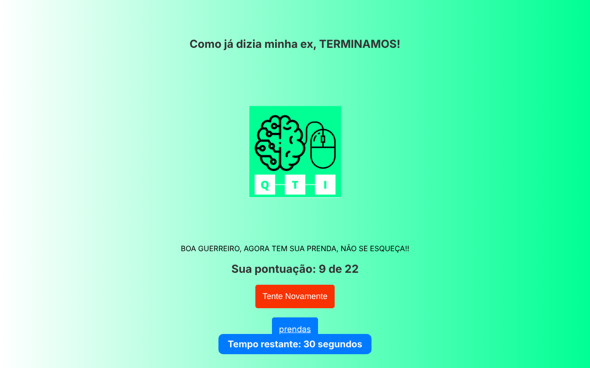
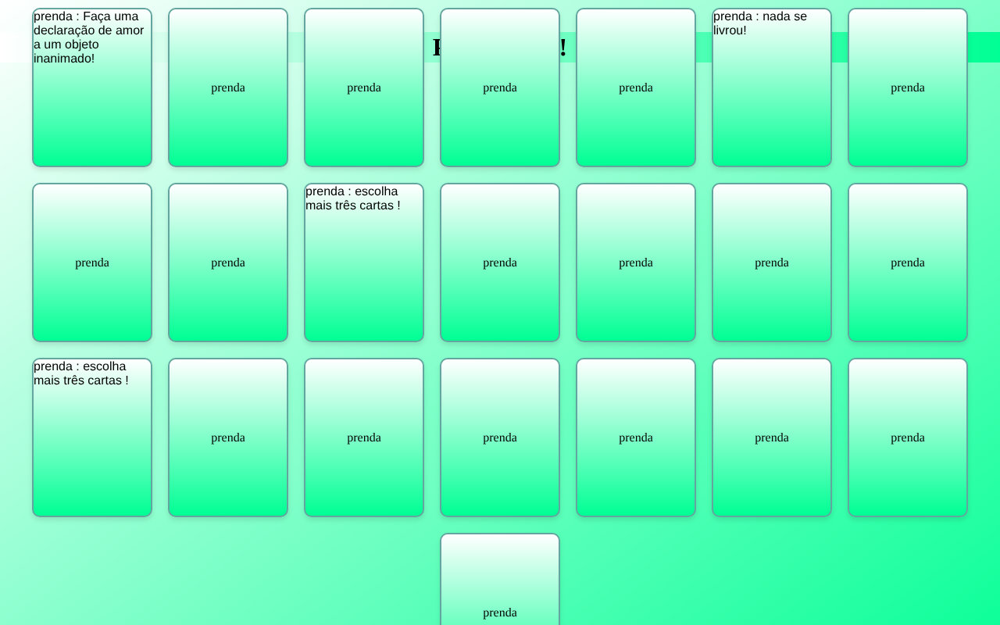

<p align="center">
  
</p>

<h1 align="center">🧠 QTI — Quiz de TI</h1>

<p align="center">
  Quiz interativo de informática que roda direto no navegador: perguntas com <b>cronômetro</b>, <b>pontuação</b>
  no final e uma tela de <b>cartas de prendas</b> para quem errou.
</p>

<p align="center">
  
  
  
  
</p>

<p align="center">
  <a href="#-sobre-o-projeto">Sobre</a> •
  <a href="#-funcionalidades">Funcionalidades</a> •
  <a href="#️-telas">Telas</a> •
  <a href="#-como-executar">Como executar</a> •
  <a href="#-estrutura-do-projeto">Estrutura</a> •
  <a href="#️-tecnologias">Tecnologias</a>
</p>

---

## 📌 Sobre o projeto

O **QTI (Quiz de Teste de Inteligência)** é um jogo de perguntas e respostas sobre **tecnologia da informação**:
redes, hardware, sistemas operacionais, internet e pacote Office. Foi feito com HTML, CSS e JavaScript puros,
sem frameworks e sem servidor: basta abrir a página no navegador.

A brincadeira tem uma segunda parte: no fim do quiz o jogador vai para a tela de **prendas**, onde vira cartas
com desafios. Pela regra da página inicial, a quantidade de erros indica o número da carta da prenda.

## ✨ Funcionalidades

| | Recurso | Descrição |
|---|---|---|
| ❓ | **22 perguntas de TI** | Firewall, IP e IPv6, proxy, virtualização, HD, SATA, processador, navegadores e mais |
| ⏱️ | **Cronômetro** | 30 segundos por pergunta; se o tempo acabar, a pergunta conta como errada e o quiz avança |
| 🔢 | **Contador** | Mostra "Pergunta X de Y" durante o jogo |
| 🏁 | **Pontuação final** | Exibe acertos sobre o total e o botão **Tente Novamente** para recomeçar |
| 🃏 | **Cartas de prendas** | 22 cartas que viram com animação ao clicar e sorteiam um desafio; botão **Reiniciar Jogo** |
| 🏠 | **Página inicial** | Explica o que é um quiz, como funciona e as regras do jogo |

## 🖼️ Telas

<table>
  <tr>
    <td align="center"><b>Início</b><br></td>
    <td align="center"><b>Pergunta com cronômetro</b><br></td>
  </tr>
  <tr>
    <td align="center"><b>Resultado</b><br></td>
    <td align="center"><b>Cartas de prendas</b><br></td>
  </tr>
</table>

## 🚀 Como executar

Não é preciso instalar nada.

```bash
git clone https://github.com/kauaxp77/quiz.git
cd quiz/Quiz_python
```

Depois abra o arquivo **`home.html`** (página inicial) ou direto o **`index.html`** (quiz) no navegador.
No VS Code, a extensão **Live Server** também funciona.

> As fontes vêm do Google Fonts; sem internet a página continua funcionando com as fontes padrão do navegador.

## 📁 Estrutura do projeto

```
quiz/
├── Quiz_python/
│   ├── home.html / home.css       # Página inicial: explicação e regras
│   ├── index.html / style.css     # Tela do quiz
│   ├── script.js                  # Perguntas, cronômetro, contador e pontuação
│   ├── cartas.html / cartas.css   # Tela das cartas de prendas
│   ├── cartas.js                  # Sorteio e virada das cartas
│   └── imagens/                   # Logo e imagens
└── docs/
    ├── banner.png
    └── screenshots/               # Capturas de tela usadas neste README
```

## 🛠️ Tecnologias

- **HTML5**: estrutura das páginas
- **CSS3**: visual, gradientes e animação de virada das cartas
- **JavaScript**: lógica do quiz, cronômetro e sorteio das prendas

## 👨‍💻 Autor

Desenvolvido por **[kauaxp77](https://github.com/kauaxp77)**

<p align="center">⭐ Se curtiu o projeto, deixe uma estrela!</p>
